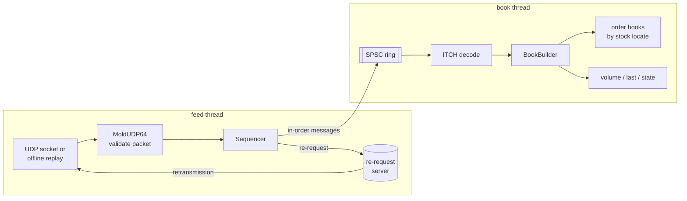

# Low-Latency Market Data Engine and Trading Simulator

A C++20 feed handler for Nasdaq TotalView-ITCH 5.0 over MoldUDP64. It decodes the binary
protocol, sequences packets, recovers from loss through re-requests, and rebuilds a full-depth
order book for every instrument. A separate component simulates order entry, pre-trade risk and
matching.

The project is built to be correct first and fast second, and to say plainly how it was checked.
No exchange data is included. Every fixture and benchmark workload is original synthetic data
produced by `mde gen`.

## What it does

- **ITCH 5.0 decoder** for all 23 message types, driven by declarative field lists. Every message
  length is checked against the spec at compile time. Malformed input is rejected with a status
  code; nothing on the data path throws.
- **MoldUDP64 receiver:**
  - validates whole packets before using any message in them;
  - a sequencer handles gaps, duplicates, reordering, heartbeats and end of session;
  - a bounded reorder buffer holds early packets, with re-request retries and an explicit
    give-up path;
  - works over real UDP, unicast or multicast, and in deterministic offline replay through a
    simulated lossy channel.
- **Order books:** a reference implementation (`std::map`/`std::list`/hash map) and an optimized
  one (order pool, open-addressing index, contiguous price levels). The two are checked against
  each other in lockstep and against a third, flat oracle.
- **Two-thread pipeline:** a feed thread hands in-order messages to a book thread through a
  single-producer/single-consumer ring buffer. A mutex queue serves as the baseline.
- **Simulated exchange:** limit orders, cancels, price-time matching, execution reports and
  positions. Pre-trade checks cover maximum order size, maximum notional, worst-case position and
  duplicate client ids. It is fully separate from ITCH, which is a market-data feed, not an
  order-entry protocol.
- **Benchmarks** for each stage, with throughput and p50/p95/p99/max, run by one command.

## Architecture



**Threads and ownership.**

- The feed thread owns the socket, the sequencer and its reorder buffer.
- The book thread owns every book. The ring is the only shared structure. Its memory ordering:
  release on publish, acquire on read, and each side caches the other's index on a separate
  128-byte cache line.
- When the ring is full, the feed thread waits. Under sustained overload the kernel socket buffer
  overflows, and the sequencer recovers the dropped datagrams by re-request.

[docs/DESIGN.md](docs/DESIGN.md) has the full design, including rejected alternatives.

## Build and test

Requirements: CMake 3.22 or later, Ninja, and a C++20 compiler. CI runs GCC 14 and clang 18 on
Ubuntu 24.04. Development used Apple clang 21 on macOS. GoogleTest is fetched at configure time,
pinned by SHA-256.

```sh
cmake --preset dev && cmake --build --preset dev && ctest --preset dev     # Debug
cmake --preset asan && cmake --build --preset asan && ctest --preset asan  # ASan + UBSan
cmake --preset tsan && cmake --build --preset tsan && ctest --preset tsan  # ThreadSanitizer
cmake --preset release && cmake --build --preset release                   # for benchmarks
```

macOS: install the tools with `brew install cmake ninja`, then use the same commands. Apple clang
supports ASan, UBSan and TSan, but has no libFuzzer runtime. The fuzz targets need upstream clang
on Linux:

```sh
cmake --preset fuzz && cmake --build --preset fuzz
./build/fuzz/fuzz/fuzz_itch -max_total_time=60
./build/fuzz/fuzz/fuzz_moldudp64 -max_total_time=60
```

CI (`.github/workflows/ci.yml`) runs:

- GCC 14 and clang 18, each in Release and in Debug with ASan+UBSan;
- clang 18 under ThreadSanitizer;
- both fuzzers for 60 s each.

All builds use `-Werror`.

## Using it

```sh
B=./build/release/apps/mde

# Synthetic ITCH file (the framing of Nasdaq's historical files), then inspect it
$B gen --out data/day.itch --messages 2000000 --symbols 64 --seed 1
$B decode data/day.itch --print 5

# Rebuild every book and print the top of book; prints a state digest
$B book data/day.itch --top 5
# --check also validates the touched book after every event. It is O(book size) per event and is
# meant for correctness runs: about 8.5 minutes for these 2M messages, so try it on a smaller file.
$B gen --out data/small.itch --messages 200000 --symbols 16 && $B book data/small.itch --check

# Replay through MoldUDP64 with 2% loss, 1% duplication and 2% reordering. The final state
# digest matches `mde book` exactly; with --no-retransmit the loss is reported instead.
$B replay data/day.itch --drop 0.02 --dup 0.01 --reorder 0.02 --pipeline spsc

# Real UDP: publish with 1% deliberate loss, receive and recover through re-requests
$B listen --port 31001 --rerequest 127.0.0.1:31002 &
$B serve data/day.itch --dest 127.0.0.1:31001 --bind 127.0.0.1:31002 --drop 0.01
# Multicast: add --group 239.255.0.1 (listen) and use it as --dest (serve);
# on macOS also pass --interface 127.0.0.1 to both

# Deterministic order-entry / risk / matching simulation
$B sim --steps 200000 --seed 7
```

Each command prints a state digest. Replaying the same file through any path (direct, lossy with
recovery, one or two threads, UDP) yields the same digest, and the tests assert this.

## Testing

There are 131 tests (`ctest`). They include:

- **Protocol golden vectors.** Every ITCH type and the MoldUDP64 header and request packets, laid
  out byte by byte from the spec's offset tables.
- **Malformed input.** Every wrong length for every ITCH type, every unassigned type byte, every
  invalid enumerated value, every truncation of a packet, and seeded mutation of whole streams.
- **Order-book correctness.**
  - Behavioural tests run against both books.
  - A property test against a flat oracle that recomputes levels by sorting.
  - An 80,000-operation lockstep differential test between the two books. It includes invalid
    operations, random 64-bit ids, and forced index growth.
- **Sequencing.** Every gap, duplicate, reorder and timeout path, plus a 40-seed property test
  that delivery is exactly once and in order under 5–10% loss with duplication and reordering.
- **Replay determinism.** Pinned digests for generated bytes, rebuilt books and simulator reports,
  identical on macOS (libc++) and Linux (libstdc++).
- **Stress and failure:**
  - 25% loss;
  - 50-packet burst losses;
  - truncated and foreign datagrams;
  - a reorder buffer of 4 packets;
  - a dead re-request server;
  - a forged 10¹² sequence jump (rejected) and a plausible 10⁹ one (handled with bounded work);
  - a two-slot ring under sustained backpressure;
  - **real kernel drops** on a 16 KB socket buffer, recovered by re-request.
- **Concurrency.** Ring and pipeline tests run under TSan in CI.

Some tests were checked by breaking the code on purpose:

- Swapping two message fields failed the golden test.
- Weakening the ring's release/acquire to relaxed made TSan report a race.
- An off-by-one in hash deletion failed the differential test.

## Performance

`./scripts/bench.sh` builds the Release configuration and runs everything. It writes a markdown
report to `bench/results/`. [docs/BENCHMARKS.md](docs/BENCHMARKS.md) covers methodology,
measurement boundaries, the profile that motivated the optimized book, and what did and didn't
help.

Selected results, from 2M synthetic messages on an Apple M4 Max with Apple clang 21 at `-O3`.
**The machine was loaded by unrelated work** (load average about 17–25 on 16 hardware threads),
so tails are noisier than on an idle host:

| Stage | Throughput | p50 | p99 |
|---|---:|---:|---:|
| ITCH decode | 117 M msg/s | 7.8 ns | 11.7 ns |
| Book updates, reference | 7.1 M ops/s | 128 ns | 470 ns |
| Book updates, optimized | 17.9 M ops/s | 51 ns | 120 ns |
| Sequencing + decode + book, one thread | 14.2 M msg/s | 64 ns | 125 ns |
| Queue handoff: mutex / naive SPSC / SPSC | 46 / 23 / 113 M/s | | |
| Paced handoff latency, SPSC vs mutex (1M msg/s) | | 84 ns vs 7.7 µs | 9.4 µs vs 396 µs |
| Order entry (risk + matching + reports) | 4.1 M req/s | 208 ns | 750 ns |

Per-operation figures below about 100 ns are averages over batches of 64 operations, because
`steady_clock` on Apple Silicon ticks every 41.7 ns.

Two results worth knowing.

- **Reserving capacity is a trade-off.** Reserving the order pool and index for the peak live
  order count removed the roughly 2 ms growth stalls (the worst 64-operation batch average fell
  from about 35 µs to about 2.5 µs). It also cost about 12% throughput, probably because a larger
  index touches more memory (I didn't measure that cause).
- **On this workload the two-thread pipeline has lower throughput than doing everything on one
  thread.** The book is the bottleneck, and handing off each message costs a cache-line transfer
  between cores. The second thread is there to keep the socket drained and re-requests flowing
  while the book works, not for throughput. Details are in BENCHMARKS.md.

## Limitations

- **Not run against real exchange data.** Nasdaq's sample files are licensed data, so every input
  here is synthetic. The synthetic order flow is plausible in shape but invented.
- **No snapshot (GLIMPSE) recovery.** After an unrecoverable gap the books stay structurally valid
  but are knowingly incomplete.
- **No kernel bypass, batched receive or hardware timestamps.** Benchmarks start from datagrams
  already in memory.
- **Broken trades are counted but don't reverse volume.**
- **The simulator has only limit orders and cancels**: no market orders, IOC, amend or self-trade
  prevention.
- **macOS has no thread affinity API.** `--pin` there only sets a QoS class.

## Repository layout

```
include/mde/        public headers: common, itch/, moldudp64/, book/, pipeline/, net/, sim/, synth/
src/                library implementations (one CMake target per component)
apps/mde/           the mde command-line tool
bench/              benchmark harness; results/ holds recorded reports
tests/              GoogleTest suites
fuzz/               libFuzzer targets
docs/               DESIGN.md, BENCHMARKS.md, JOURNAL.md (engineering log), STATUS.md
```

## How this was built

Kenneth Camacho directed and reviewed this project. Much of the code and documentation was
written with an AI assistant (Claude, via Claude Code), and commits carry a `Co-Authored-By`
trailer. [docs/JOURNAL.md](docs/JOURNAL.md) records decisions, bugs and measurements as they
happened, including the ones that went wrong.

License: MIT.
