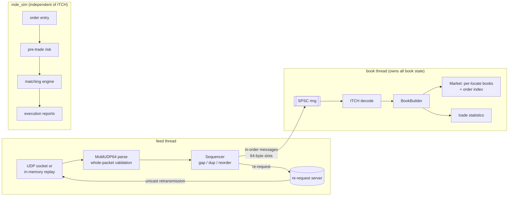

# Technical Design

This document describes the system as built. Its history, including what changed and why, is in
[JOURNAL.md](JOURNAL.md). Measurements are in [BENCHMARKS.md](BENCHMARKS.md).

## 1. Scope

The system ingests Nasdaq TotalView-ITCH 5.0 market data carried over MoldUDP64. It rebuilds a
full-depth limit order book for each instrument and exposes best bid/ask, spread, depth, order
queues and volume. A separate component simulates order entry, pre-trade risk checks and
matching.

Out of scope:

- connecting to a real exchange or broker;
- redistributing exchange data;
- SoupBinTCP and GLIMPSE snapshot recovery;
- kernel-bypass networking.

Section 9 explains what each omission means in practice.

## 2. Sources

All protocol behaviour comes from the two official Nasdaq documents. Both were read in full before
any code was written.

| Document | Version read |
|---|---|
| Nasdaq TotalView-ITCH 5.0 | revision log ending April 28, 2023 (adds the DLCR message) |
| MoldUDP64 Protocol Specification | V1.00, formatting update 8/2/24 |

Where this project takes a position the specifications leave open, the choice is marked
**policy**.

## 3. Protocol facts the design depends on

### MoldUDP64

A downstream packet has a 20-byte header: session (10 ASCII bytes), the sequence number of its
first message (u64), and a message count (u16). The header is followed by `count` message blocks,
each a big-endian u16 length and that many bytes. A count of `0` is a heartbeat and `0xFFFF` marks
end of session. Both carry the **next** sequence number, so a receiver can detect messages lost at
the end of a burst even when no data follows.

A re-request is a 20-byte packet (session, first sequence, count) sent to a re-request server. The
server answers with an ordinary downstream packet unicast back to the requesting socket. It may
return fewer messages than asked if they don't fit in one datagram.

### ITCH 5.0

Every message begins with an 11-byte header: type, stock locate (u16), tracking number (u16) and
timestamp (6 bytes, nanoseconds since midnight). Integers are big-endian. Prices are fixed-point
integers: `Price(4)` has 4 implied decimals, `Price(8)` has 8. There are 23 message types, each
with one fixed length. All 23 lengths are checked against the spec at compile time.

| Affects the book | Affects volume only | Neither |
|---|---|---|
| `A` `F` add, `E` `C` execute, `X` cancel, `D` delete, `U` replace | `P` trade (non-displayed orders), `Q` cross | `S` `R` `H` `Y` `L` `V` `W` `K` `J` `h` `I` `N` `O`, `B` (broken trade) |

The details that matter:

- **`P` reports executions of non-displayed orders.** No Add was ever sent for those orders, so
  applying `P` to the book would be wrong.
- **A `C` with Printable = `N` is reported again in a later bulk print**, usually the cross. It
  reduces the order but must not count toward volume.
- **The book reduction for `C` happens at the resting order's price**, not at the execution price
  carried in the message.
- **`U` doesn't transmit side, symbol or attribution.** They carry over from the original order,
  and the replacement loses time priority.
- **Order reference numbers are unique for the day, but not guaranteed to increase.** That
  guarantee was removed in 2009, so they can't be used as array indices.
- **Stock locate codes are dense and start at 1 each day.** The spec intends them as array
  indices.
- **The book can be locked or crossed before the opening cross.** "Bid < ask" is therefore
  reported, never asserted.

The offline file format is Nasdaq's historical ITCH files: the same `[u16 length][message]`
framing as a MoldUDP64 message block. One bounds-checked reader (`mde::FramedReader`) handles both.

## 4. Architecture

Libraries (one CMake target each; dependencies point one way):

| Target | Contents | Depends on |
|---|---|---|
| `mde_common` | big-endian loads/stores, framing, `Rng`, `Digest` | — |
| `mde_itch` | ITCH 5.0 message types, decoder, encoder, printer | common |
| `mde_book` | `ReferenceMarket`, `FastMarket`, `BookBuilder` | itch |
| `mde_moldudp64` | packet codec, `Sequencer`, `MessageLog`, lossy replay | common |
| `mde_net` | POSIX UDP socket, publisher, receive loop | moldudp64 |
| `mde_pipeline` | `SpscQueue`, `MutexQueue`, two-thread `run()` | common, Threads |
| `mde_synth` | synthetic ITCH generator | itch, book |
| `mde_sim` | `Exchange` (risk + matching), `OrderFlow`, simulator | common |

## 5. Component design

### 5.1 ITCH codec

Each message struct lists its fields in wire order through `MDE_WIRE_FIELDS(...)`. That produces a
`std::tie` of its members, plus the field names for printing. One generic routine reads every
message and one writes every message. The wire size of each struct is computed from its field
types and `static_assert`ed against the spec length.

At `-O2`, `read<AddOrder>` compiles to straight-line code: a load at a constant offset, a byte
swap and a store per field. That is what a hand-written decoder produces.

**Rejected alternatives:**

- **Packed structs read with `reinterpret_cast`.** That is undefined behaviour, still needs byte
  swaps, and depends on alignment.
- **46 hand-written read and write functions.** Twice the review surface, and no compile-time check
  that a layout matches the spec.

**Policy:**

- A message whose length differs from its type's spec length is rejected, even if it is only
  longer.
- Only fields that change book or volume semantics are validated: Buy/Sell must be `B` or `S`,
  Printable must be `Y` or `N`.
- Rejections are `DecodeStatus` values. Nothing throws on the data path.

### 5.2 MoldUDP64 sequencing (`moldudp64::Sequencer`)

`parse()` checks the header and walks every block before reporting success.

**Policy:** a datagram with a truncated block, trailing bytes, or a sequence+count that overflows is
dropped whole. It is then indistinguishable from a lost packet and recovered the same way. That
rules out ever applying half of a damaged packet.

The sequencer is a pure state machine. Datagrams and timestamps go in; in-order messages and
re-requests come out. It owns no socket and reads no clock, so every loss pattern can be unit-tested
and offline replay is deterministic. It tracks:

- `next_`: the next sequence number to deliver;
- `upstream_next_`: the highest "next sequence" any packet or heartbeat has shown;
- `pending_`: out-of-order packets keyed by first sequence, bounded at 4,096 by default.

Delivery is exactly once and in order. Partly duplicated packets have only their new messages
delivered; retransmissions may be split differently from the originals.

**Gap policy (the spec leaves it to the receiver):**

- A request covers only the hole up to the first buffered packet, at most `max_request_count`
  messages. Requests repeat after `request_timeout_ns`, and any progress resets the retry budget.
- After `max_request_attempts`, the hole is skipped. The skipped messages are counted in
  `messages_lost` and delivery continues from the buffer. The book then knows it is incomplete;
  later references to lost orders show up as `kUnknownOrder` anomalies, never crashes.
- With re-requests disabled, a hole is skipped one timeout after it was *revealed*, meaning the
  packet after it arrived. The first version started that timeout when the hole reached the head of
  the line. Holes then expired one after another and overflowed the buffer; the journal entry for
  milestone 5 has the numbers.

**Rejected:** the spec's sample receiver ignores every packet after a gap until the re-request is
answered. Under load that turns one lost packet into a re-request for everything sent in the
meantime. Buffering the packets after the hole (bounded) and asking only for the hole avoids that.

### 5.3 Order books

Both markets implement the `book::Market` concept and the same `Result` policy for input that
contradicts their state:

- **Rejected with no side effects:** duplicate add, unknown order, locate mismatch, zero quantity.
- **Clamped:** a reduce by more than the remaining size removes the order and reports
  `kOverfill`.

`BookBuilder<Market>` maps ITCH messages onto the market and keeps per-instrument statistics:
volume, trade count, last price and trading state. With `check_invariants` enabled it fully
validates the touched book after every event. `mde book --check` uses that mode.

**`ReferenceMarket`** is the obviously-correct version: a `std::map` of levels per side, a
`std::list` FIFO per level, and an `unordered_map` from order id to list iterator. Profiling it
(see BENCHMARKS.md) put about 36% of samples in `malloc`/`free` and most of the rest in
pointer-chasing.

**`FastMarket`** keeps the same semantics with a different layout:

- **Orders:** a pool (`std::vector<Order>`, 32 bytes each) with a free list. Levels link their
  orders in a FIFO by 32-bit pool indices. Nothing is allocated per order once warm.
- **Order index:** open addressing with linear probing and Fibonacci hashing, kept at most half
  full. Deletion uses backward shift instead of tombstones, so probe lengths don't degrade over a
  day of adds and deletes.
- **Levels:** a sorted `std::vector` of 24-byte entries per side, with the best price at the back.
  Activity concentrates near the touch, so lookup is a short scan from the back, and insert/erase
  near the touch moves few elements.
- **Instruments:** one book per locate code in a flat 65,536-entry array, as the spec intends.

**Rejected for `FastMarket`:**

- **A price-indexed ladder array per instrument** (O(1) level access). It needs a price band per
  instrument and recentring when the price moves outside it, and costs memory for thousands of
  mostly-quiet instruments. Measured level lookups were not the bottleneck.
- **Separate hash maps per instrument.** Order references are day-unique across instruments, so a
  single index is enough, and every modify message carries the locate for validation anyway.

**Verification:**

- The behavioural tests are typed tests run against both markets.
- Both are checked against a third, flat oracle that recomputes levels by sorting a list of orders.
- A lockstep differential test compares the two markets under 80,000 random operations,
  including invalid ones. It uses sequential and random 64-bit ids, and starts `FastMarket` at a
  capacity of 16 so its index and pool grow repeatedly.
- Replaying the synthetic stream through both produces the same pinned digest.

### 5.4 Pipeline (`mde_pipeline`)

- **Feed thread:** receives packets, runs the sequencer, and copies each in-order message into a
  64-byte `MessageSlot` (receive timestamp, length, data). The largest ITCH message is 50 bytes.
- **Book thread:** pops slots, decodes and applies them. It is the only thread that touches book
  state while the pipeline runs. The join at the end of `run()` publishes that state to the caller.

**`SpscQueue<T, N>` memory ordering.** Head and tail are positions that only increase, masked to
index the ring.

- The producer writes the slot, then stores `tail_` with `release`.
- The consumer loads `tail_` with `acquire`, so it sees the slot contents.
- The consumer copies the slot out, then stores `head_` with `release`.
- The producer loads `head_` with `acquire` before it reuses the slot.

Each side reads its own index `relaxed`, because only it writes it. Each side also keeps a cached
copy of the other's index and refreshes it only when the ring looks full or empty. Producer-owned
and consumer-owned fields sit on separate 128-byte lines (Apple Silicon reports 128-byte lines).

**Backpressure.** When the ring is full, the feed thread spins and counts it in `full_waits`;
nothing is dropped in-process. During a live run, the kernel socket buffer, sized to 8 MB on
request, absorbs bursts. If it overflows, the kernel drops datagrams and the sequencer recovers
them by re-request. Blocking the feed thread therefore converts in-process overload into network
loss, which the protocol is designed to recover from.

`MutexQueue` is the baseline: a bounded `std::deque` under a `std::mutex`, with the same
non-blocking interface.

### 5.5 Simulated exchange (`mde_sim`)

ITCH is an outbound market-data feed and has no order-entry semantics. The simulator therefore
uses its own message types and shares nothing with the ITCH side.

**Pre-trade risk checks**, in order:

1. instrument exists
2. price > 0
3. quantity > 0
4. client order id not used before by this account
5. quantity ≤ `max_order_quantity`
6. `price * quantity ≤ max_order_notional`, evaluated as `price > max / quantity` so it cannot
   overflow
7. worst-case position: `net + open buys + new buy ≤ max_position`, and the mirror for sells

**Matching.** Price-time priority, executed at the resting order's price, never trading through
the limit price. Every fill produces execution reports for both sides with cumulative and leaves
quantities. Positions and open quantities update as fills happen.

**Determinism.** `OrderFlow` generates seeded requests. It learns which orders are live only
from execution reports, as a client would.

### 5.6 Determinism

- No wall-clock reads in generation, replay or simulation.
- Randomness comes from SplitMix64 (`mde::Rng`), not `<random>` distributions, whose output differs
  between libstdc++ and libc++.
- State digests are FNV-1a over values fed in a fixed byte order.
- Tests pin the bytes of a synthetic file, the book digest after replaying it, and the simulator's
  report digest. They pass identically on macOS (libc++) and Linux (libstdc++).

## 6. Testing strategy

| Kind | Where |
|---|---|
| Golden vectors, every ITCH type, field offsets from the spec | `tests/test_itch_golden.cpp` |
| Malformed input: every length, type byte, enum value; seeded mutation | `tests/test_itch_malformed.cpp` |
| Encode/decode round trip, all types | `tests/test_itch_codec.cpp` |
| MoldUDP64 golden vectors, malformed packets, every truncation | `tests/test_moldudp64.cpp` |
| Sequencer: every loss/duplicate/reorder/timeout path; 40-seed impairment property | `tests/test_sequencer.cpp` |
| Book behaviour (both markets), flat-oracle property, lockstep differential | `tests/test_market.cpp` |
| ITCH → book semantics (P/Q/C/B, unknown orders) | `tests/test_book_builder.cpp` |
| Synthetic data consistency, determinism, cross-platform digests | `tests/test_synth.cpp` |
| Lossy replay recovery, determinism, unrecoverable loss, real UDP loopback | `tests/test_replay.cpp` |
| Queue semantics, two-thread ordering, pipeline equivalence (TSan) | `tests/test_pipeline.cpp` |
| Matching, risk, reports, position conservation, determinism | `tests/test_sim.cpp` |
| libFuzzer: ITCH stream; MoldUDP64 datagrams into the sequencer | `fuzz/` |

I checked the tests themselves by deliberately breaking code:

- Swapping two same-width fields in a message definition failed the golden test.
- Weakening the SPSC release/acquire pair to relaxed made TSan report a race.
- An off-by-one in hash-index deletion failed the differential test.

## 7. Threads, ownership and synchronization summary

| State | Owner | Shared how |
|---|---|---|
| socket, sequencer, reorder buffer | feed thread | not shared |
| ring slots | producer until `tail_` release; consumer until `head_` release | SPSC ring |
| markets, `BookBuilder` statistics | book thread | published to the caller by `join()` |
| `PipelineStats` | feed thread | returned after `join()` |
| publisher (`mde serve`) | its own thread or process | UDP only |

## 8. Error handling

- **Decode, packet and book anomalies:** counted, never thrown, and reported by the CLI.
- **Socket set-up failures:** thrown as `std::system_error`.
- **Socket errors:** `EINTR` is retried. `ENOBUFS` on send is treated as loss, which the protocol
  recovers.
- **CLI:** every command catches exceptions at the top level and exits non-zero. `mde book --check`
  and `mde replay` also exit non-zero on invariant violations or an incomplete session.

## 9. Limitations

- **No real exchange data has been run through this code.** Nasdaq's sample files are licensed
  data. Everything was tested against the specification and original synthetic data.
- **Synthetic flow is not real flow.** The generator concentrates activity near the touch and
  cancels more often than it fills, but its distributions are invented. Benchmark numbers describe
  this workload only.
- **No snapshot recovery (GLIMPSE).** After an unrecoverable gap, the books stay structurally
  valid but are knowingly incomplete until the next session.
- **Broken trades are counted but don't reverse volume.** Reversing them would need an index of
  every execution's match number for the day.
- **No kernel bypass, no `recvmmsg` batching, no hardware timestamps.** Receive timestamps come
  from `steady_clock` after `recvfrom` returns.
- **macOS has no hard CPU affinity**, so `--pin` there only sets a QoS class. Multicast through the
  default interface didn't deliver locally on the development Mac; loopback multicast works.
- **The simulator has no self-trade prevention, market orders, IOC or amend.**
